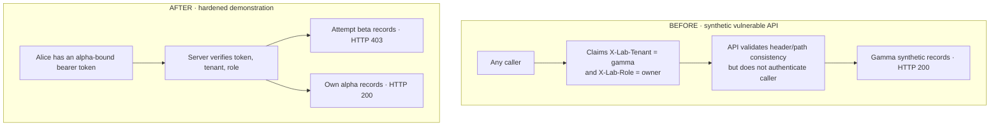

# Case P02 — Tenant Isolation & Server-Side Authorization

**B2B SaaS · API authorization · synthetic security lab (E4 internal classification)**

> **Not a client incident.** The observations below come from a deliberately vulnerable FastAPI fixture and a local example fix. No organization, real account, customer data, or production database was tested.

## The customer-facing question

**Can an authenticated user from company A read company B's records — or can an unauthenticated caller merely *claim* to be company B?**

In a multi-tenant SaaS, user-supplied tenant/role headers are not proof of identity. A correctly formatted request may still belong to the wrong person.

## Threat boundary, explained

**Important nuance:** the Before implementation already returned **403** if the tenant header and URL *disagreed* (P02-02/P02-04). The weakness was **not** a failure of that equality check. The weakness was that **the caller could choose both the URL tenant and the claimed header tenant without authentication**.

## Evidence / findings

| Check | Recorded observation | Link |
| --- | --- | --- |
| P02-03: caller sets a matching tenant claim | **Before: 200** with synthetic target-tenant records | [Baseline results](../../artifacts/verification-v2.json) |
| P02-02/P02-04: mismatched path and claimed tenant | **Before: 403** (normal control, not a finding) | [Baseline results](../../artifacts/verification-v2.json) |
| BA-01: authorized request | **Before: 200 → After: 200**, same response body | [After comparison](../../artifacts/before_after_results.csv) |
| BA-02: anonymous request | **After: 401** | [After comparison](../../artifacts/before_after_results.csv) |
| BA-03: alpha principal attempts beta | **After: 403** | [After comparison](../../artifacts/before_after_results.csv) |
| BA-04: member self-claims owner on privileged demo route | **After: 403**; real owner remains **200** | [After comparison](../../artifacts/before_after_results.csv) |

The baseline records route did not distinguish the claimed owner and viewer responses. The privileged `admin-report` route is an **additional After-only regression control**; it must not be described as a corresponding baseline admin endpoint being patched.

## Remediation pattern

The demonstration replaces unauthenticated user claims with per-account random passwords (ephemeral PBKDF2-salted test fixture), server-issued bearer tokens, and server-side tenant/role checks. The client cannot grant itself a new role by changing `X-Lab-Role`.

- **Root cause:** request-provided identity treated as authority.
- **Fix principle:** authenticate a principal, then derive tenant/role from server-side trusted state and enforce authorization at each protected handler.
- **Verification:** valid access still works while anonymous, cross-tenant, and role-spoofing requests fail as specified.

## What an actual customer assessment would include

A written role/tenant matrix, separately authorized staging identities, representative object-level API tests, a confidential finding with risk and remediation, and a narrow post-fix retest. The precise coverage and permissions would be agreed in writing before testing.

## Scope / evidence limitations

The fixture defines **three tenants and eight possible roles**, but only selected HTTP routes and scenarios were exercised. There is **no write, export, production SSO, JWT lifecycle, MFA, PostgreSQL RLS, or real customer application** in this case. The demo token issuer is not a production identity service.

**Reproduce:** `bash scripts/reproduce_all.sh` from the repo root. See [corrected run report](../../reports/REVALIDATION_V2.md) and [synthetic output](../../artifacts/verification-v2.json). Earlier raw logs remain preserved under `evidence/private/` and contain historical assertion errors, so the v2 run is authoritative.

**한국어 요약:** 요청자가 테넌트 헤더와 경로를 동시에 조작하면 다른 조직의 합성 데이터가 반환되는 인증 부재를 재현했습니다. 보완 후에는 서버에서 인증·테넌트·역할을 검증해 정상 사용자는 200, 익명 사용자는 401, 타 테넌트는 403을 확인했습니다.
