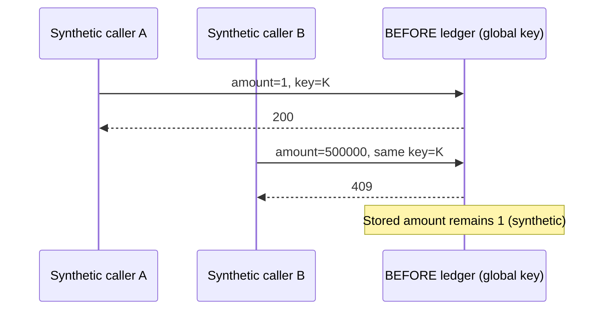
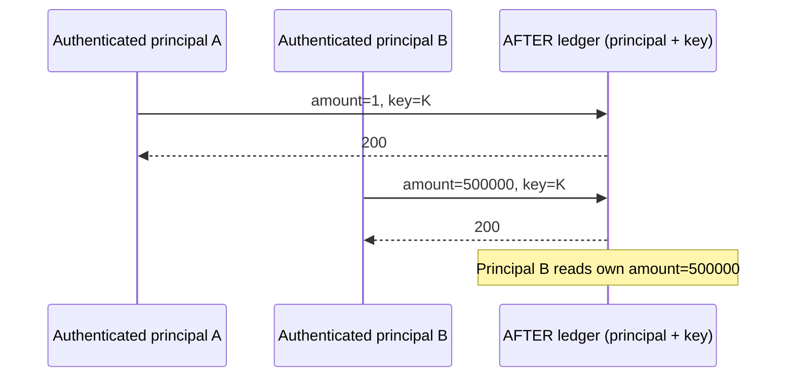

# Case P04 — Payment Ownership & Idempotency Boundaries

**E-commerce / reservations · business-logic security · synthetic SQLite ledger (E4 internal classification)**

> **Not a real payment compromise.** Amounts and payment status values are synthetic fixture data; no gateway, settlement, refund, webhook, banking system, or actual customer transaction was involved.

## The customer-facing question

**Could someone view a payment by knowing its key, or block a legitimate order by reserving the same idempotency key first?**

Payment APIs need both **object ownership** and **transaction/request isolation**. An idempotency key is not an authorization credential.

## What happened in the lab

The original fixture was **unauthenticated**, so “A” and “B” in the Before example are distinguishable *callers in the test sequence*, not securely identified customers. The After implementation authenticates each principal and scopes the database key by `(principal, idempotency_key)`. It is **not** an implemented merchant-wide order-scoped idempotency design.

## Finding-to-fix evidence

| Scenario | Before | After / retest |
| --- | --- | --- |
| P04-10 / BA-05 · GET a known payment key anonymously | **200** with synthetic amount/status | Anonymous **401**; correct owner **200**; other authenticated principal **404** |
| P04-12..15 / BA-06 · reuse one key across callers | A 1 KRW **200**, B 500,000 KRW **409**; stored amount **1** | Separate authenticated principals both **200**; principal B sees **500,000** |
| P04-05..07 / BA-07 · coerced monetary input | `"1000"` accepted **200**; boolean/float also accepted | StrictInt rejects string/boolean/float with **422** |
| P04-18 / SEC-concurrent-same-principal · competing bodies, same key | **[200, 409]** | **[200, 409]**, expected atomic conflict behavior |

**Do not mislabel the concurrency baseline as a race vulnerability:** its recorded `[200, 409]` split was already a valid atomicity control. The issue was **global key scoping and missing object authorization**, not “concurrency broken.”

[Machine-readable 51-case evidence](../../artifacts/verification-v2.json) · [Comparison matrix](../../artifacts/before_after_results.csv) · [Independent retest report](../../reports/REVALIDATION_V2.md)

## Root cause and design changes

- **Unauthenticated lookup:** knowing a key was sufficient to read a synthetic payment. Add bearer authentication and owner-bound reads; return **404** to other principals.
- **Global idempotency namespace:** unrelated callers interfered through the same key. Scope the key by verified principal, store a request fingerprint, reject altered retries, and serialize writes using a SQLite transaction.
- **Permissive amount coercion:** the Before Pydantic `int` field accepted strings/bools/floats. The After `StrictInt` field accepts only integer JSON values in the allowed range.

## What a real engagement would verify

Authorized checkout/order/payment APIs: user ownership, duplicate requests, retry semantics, amount/currency validation, cross-account negative paths, and remediation retest. Real payment service providers, hosted checkout pages, webhook signing, refunds, chargebacks, and settlement reconciliation require **separate authorization and scope** and were not demonstrated here.

**Reproduce:** `bash scripts/reproduce_all.sh`; the runner uses loopback-only ephemeral ports and temporary SQLite databases. The preserved earlier logs under `evidence/private/` contain false-negative harness labels; trust the corrected v2 assertions rather than interpreting those logs as the latest result.

**한국어 요약:** 합성 결제 원장에서 무인증 결제 조회 및 전역 멱등성 키 충돌을 재현했습니다. 수정 후 익명 401 / 소유자 200 / 다른 사용자 404, 사용자별 동일 키 독립 처리, 금액 타입 엄격 검증을 확인했습니다. PG 실거래나 실제 금전 피해의 증거는 아닙니다.
